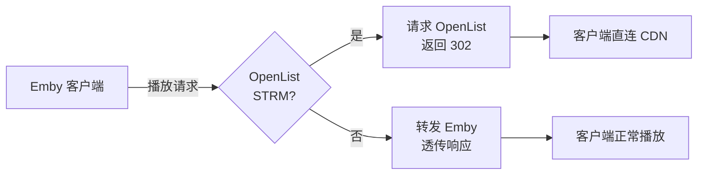

# Emby302Gateway

将 Emby STRM 播放请求重定向到 OpenList 返回的 CDN 直链地址。

## 原理



## 前提：

STRM 指向 OpenList 的 `/d/...` 文件地址。

可用示例：

```
https://openlist.example.com/d/Movies/example.mp4
http://localhost:5244/d/example.mp4
```

无效示例：

```
https://openlist.example.com/p/Movies/example.mp4
https://openlist.example.com/s/example.mp4
https://cdn.example.com/file/example.mp4
115://xxx
alist://xxx
```

## 安装：

克隆此仓库到本地：

```
git clone https://github.com/qvshuo/Emby302Gateway.git --depth=1 && cd Emby302Gateway
```

## 配置：

```
cp .env.example .env
```

编辑 `.env` 文件，根据实际情况填写：

```
EMBY_HOST=http://localhost:8096
EMBY_API_KEY=your_emby_api_key
OPENLIST_ADDR=http://localhost:5244
OPENLIST_TOKEN=your_openlist_token
```

OpenList 令牌位于「管理 → 设置 → 其他 → 令牌」。

## 启动：

使用 Docker Compose：

```bash
docker compose up -d --build
```

## 连接：

将 Emby 客户端的服务器地址配置为此网关地址：`http://你的服务器IP:18096`；

播放 STRM 视频时，实际请求将通过 302 重定向解析为 OpenList 返回的 CDN 直链，从而不再受 Emby 所在设备的网络带宽限制；本地视频及其他无法解析为 OpenList 直链的资源，由本网关透传给 Emby 处理。

## 教程：

[OpenList + STRM + rclone + Emby + 302 重定向网关（Deno）的家庭影院部署方案](https://anjing.art/posts/2026-01-16-OpenList%20+%20STRM%20+%20rclone%20+%20Emby%20+%20302%20重定向网关（Deno）的家庭影院部署方案)

## License

MIT
