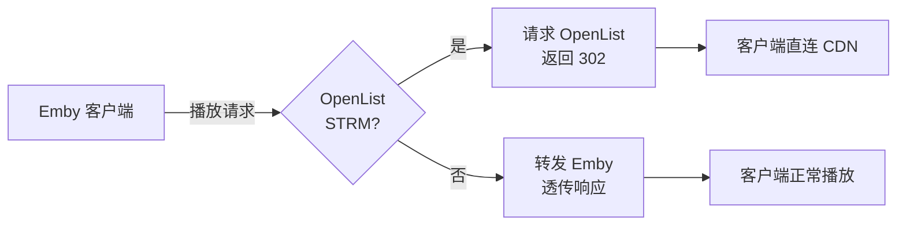

# Emby302Gateway

通过 Go 标准库运行，将 Emby STRM 播放请求重定向到 OpenList 返回的 CDN 直链地址。

## 原理



## 前提：

STRM 指向 `OPENLIST_ADDR` 对应站点的 HTTP(S) `/d/...` 文件地址，协议、主机及端口须一致。其他站点和相对路径交给 Emby 处理。

使用 OpenList 内置 STRM 驱动时，以最终生成的文件内容为准：应包含 Emby 和网关都可访问的完整 URL，并与 `OPENLIST_ADDR` 一致。不要仅根据某个驱动或全局设置字段判断地址是否完整；Emby 在 Docker 中运行时也不要使用容器自身的 `localhost`。

若重新生成时替换了整个挂载目录，需重新创建 Emby 容器以重新绑定目录。宿主机文件存在但容器内不可见时，应先检查挂载，无需改写 STRM 内容。

可用示例：

```
https://openlist.example.com/d/Movies/example.mp4
http://localhost:5244/d/example.mp4
```

无效示例：

```
https://openlist.example.com/p/Movies/example.mp4
https://openlist.example.com/s/example.mp4
https://cdn.example.com/file/example.mp4
115://xxx
alist://xxx
```

## 安装：

克隆 [Emby302Gateway](https://github.com/qvshuo/Emby302Gateway) 到本地：

```
git clone https://github.com/qvshuo/Emby302Gateway.git --depth=1 && cd Emby302Gateway
```

安装 Go 1.23 或更新版本；项目仅使用标准库，没有第三方依赖。

## 配置：

```
cp .env.example .env
```

编辑 `.env` 文件，根据实际情况填写：

```
EMBY_HOST=http://localhost:8096
EMBY_API_KEY=your_emby_api_key
OPENLIST_ADDR=http://localhost:5244
OPENLIST_TOKEN=your_openlist_token
PORT=18096
CACHE_TTL=180
```

OpenList 令牌位于「管理 → 设置 → 其他 → 令牌」。配置注释请独占一行。

## 启动：

```
go run .
```

后台运行：

```
go build -trimpath -ldflags="-s -w" -o gateway .
nohup ./gateway >> /tmp/emby302gateway.log 2>&1 &
```

## Docker Compose：

```bash
docker compose up -d --build
docker compose logs -f gateway
```

使用 host 网络以保持 `.env` 中 localhost 地址的含义（适用于 Linux）。配置文件以只读方式挂载，默认监听 18096。无需 Deno、Node.js 或数据库。

## 开发与验证：

```bash
gofmt -w main.go main_test.go
go test -race ./...
go vet ./...
go build .
```

运行逻辑集中在 `main.go`，测试位于 `main_test.go`。从当前工作目录读取 `.env`，四个必填项保持不变；`PORT`、`CACHE_TTL` 必须为正整数。不要提交 `.env`。

## 行为：

- 仅处理配置的 OpenList 远程非直播源：PlaybackInfo 强制直放并生成相对播放 URL，保留客户端凭据与 `PlaySessionId`，播放 URL 不重复携带客户端 API 基路径；Header 认证会将调用方 Token 放入播放 URL，供无法附加请求头的播放器使用。
- 仅对视频 GET 的 `stream[.扩展名]?Static=true`、`original[.扩展名]` 返回 302。HEAD、转码、其他站点、本地/rclone、直播、音频、下载及其他 API 均透传；支持 `/emby` 前缀和 `EMBY_HOST` 中的上游路径前缀。
- 使用 Go 标准库反向代理，保留上游状态、请求体、响应头及重定向，支持 Range、流式响应和 WebSocket。System/Info 保持原样。
- Emby 网页播放器仅为网关处理的 OpenList 源移除 CORS 限制；其他媒体保留原逻辑。
- 解析前用客户端凭据查询 Emby；普通用户还需确认身份与播放权限，无法确认时透传。配置的 `EMBY_API_KEY` 仅识别受信任的集成凭据，不用于代替客户端认证，不会用配置密钥补齐播放 URL。
- CDN 缓存按 OpenList 路径和 User-Agent 区分，TTL 默认 180 秒，最多 1024 条；缓存命中前仍检查 Emby。解析等待最多 15 秒，失败回源 Emby。
- 日志输出至 stdout/stderr，记录处理结果及解析失败分类，不输出 Token 或 CDN 签名直链。
- 收到 SIGINT/SIGTERM 后停止接收新连接，最多等待 15 秒完成活跃 HTTP 请求；超时后关闭连接。已升级的 WebSocket 不在此等待范围内，客户端需重连。Compose 停止宽限期为 20 秒。

直链播放需要客户端支持原始媒体格式并能访问 CDN；网关不会为 OpenList 源转码。未处理的媒体继续使用 Emby 的播放与转码能力。

实现依据：[Emby 视频串流](https://dev.emby.media/doc/restapi/Video-Streaming.html)、[PlaybackInfo](https://dev.emby.media/reference/RestAPI/MediaInfoService/postItemsByIdPlaybackinfo.html)、[用户认证](https://dev.emby.media/doc/restapi/User-Authentication.html)。

## 连接：

将 Emby 客户端的服务器地址配置为网关地址：`http://你的服务器IP:18096`；

播放 STRM 视频时，实际请求将通过 302 重定向解析为 OpenList 返回的 CDN 直链，从而不再受 Emby 所在设备的网络带宽限制；本地视频及其他无法解析为 OpenList 直链的资源，由本网关透传给 Emby 处理。

## 教程：

[OpenList + STRM + rclone + Emby + 302 重定向网关（Deno）的家庭影院部署方案](https://anjing.art/posts/2026-01-16-OpenList%20+%20STRM%20+%20rclone%20+%20Emby%20+%20302%20重定向网关（Deno）的家庭影院部署方案)

## License

MIT
