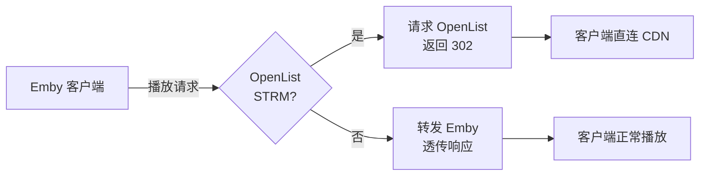

# Emby302Gateway

通过 Go 标准库运行，将 Emby STRM 播放请求重定向到 OpenList 返回的 CDN 直链地址。

## 原理



## 前提：

STRM 使用完整的 HTTP(S) `/d/...` 地址，与 `OPENLIST_ADDR` 的协议、主机和端口一致，并可被 Emby 及网关访问。

可用示例：

```
https://openlist.example.com/d/Movies/example.mp4
http://localhost:5244/d/example.mp4
```

无效示例：

```
https://openlist.example.com/p/Movies/example.mp4
https://openlist.example.com/s/example.mp4
https://cdn.example.com/file/example.mp4
115://xxx
alist://xxx
```

## 安装：

克隆 [Emby302Gateway](https://github.com/qvshuo/Emby302Gateway) 到本地：

```
git clone https://github.com/qvshuo/Emby302Gateway.git --depth=1 && cd Emby302Gateway
```

安装 Go 1.23 或更新版本，无第三方依赖。

## 配置：

```
cp .env.example .env
```

编辑 `.env` 文件，根据实际情况填写：

```
EMBY_HOST=http://localhost:8096
EMBY_API_KEY=your_emby_api_key
OPENLIST_ADDR=http://localhost:5244
OPENLIST_TOKEN=your_openlist_token
PORT=18096
CACHE_TTL=180
```

OpenList 令牌位于「管理 → 设置 → 其他 → 令牌」。默认端口 18096，缓存 180 秒；不要提交 `.env`。

## 启动：

```
go run .
```

后台运行：

```
go build -trimpath -ldflags="-s -w" -o gateway .
nohup ./gateway >> /tmp/emby302gateway.log 2>&1 &
```

或使用 Docker Compose（Linux host 网络）：

```bash
docker compose up -d --build
docker compose logs -f gateway
```

## 连接：

将 Emby 客户端的服务器地址配置为网关地址：`http://你的服务器IP:18096`；

仅将 OpenList STRM 视频播放重定向到 CDN，其他请求及解析失败均回源 Emby。客户端须支持原始媒体格式并可访问 CDN。

## 教程：

[OpenList + STRM + rclone + Emby + 302 重定向网关（Deno）的家庭影院部署方案](https://anjing.art/posts/2026-01-16-OpenList%20+%20STRM%20+%20rclone%20+%20Emby%20+%20302%20重定向网关（Deno）的家庭影院部署方案)

## License

MIT
